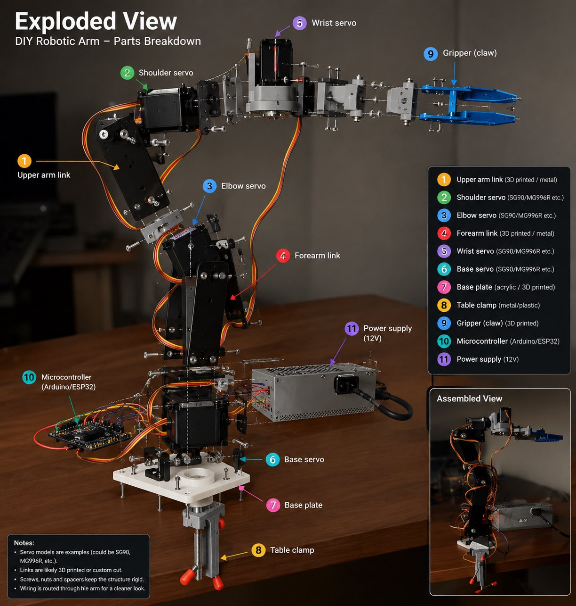
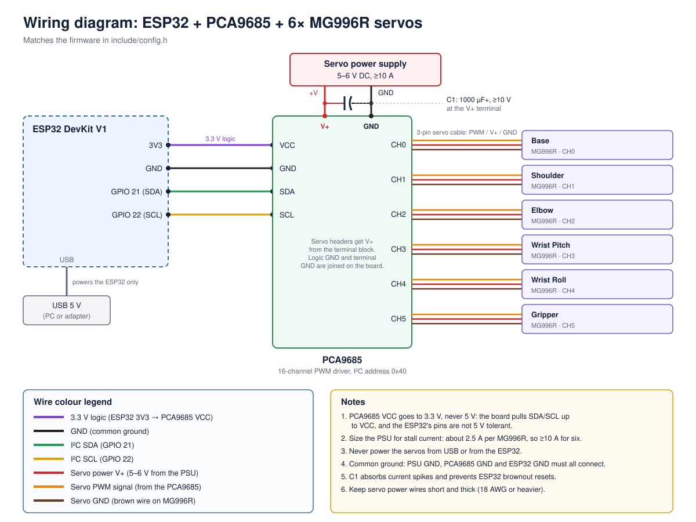

# robotic-arm

A 6-DOF robotic arm built from MG996R servos, driven by an ESP32 through a PCA9685 PWM board. The ESP32 hosts its own Wi-Fi access point and a web page, so you can control the arm from any phone or laptop without installing anything.



## Features

- **Web controller.** One slider per joint, preset poses, and speed presets. Several phones can connect at once and stay in sync.
- **Smooth motion.** Every move accelerates and decelerates instead of jumping. Pose moves are synchronised so all joints arrive at the same moment.
- **Safety.** Per-joint soft limits enforced on the ESP32, a latched emergency stop, and a dead-man timeout that stops the arm if the controlling phone disconnects.
- **Gentle startup.** Servos are powered one at a time from the last saved pose. If only the ESP32 resets, the arm keeps holding its position without moving.
- **Fault handling.** The PCA9685 is checked at boot and while running. A loose I2C wire raises a fault in the UI and recovers automatically when it is reconnected.

## Hardware

| Part | Qty | Notes |
|---|---|---|
| ESP32 DevKit V1 | 1 | Powered over USB |
| PCA9685 16-channel PWM driver | 1 | I²C address `0x40` |
| MG996R servo | 6 | Base, shoulder, elbow, wrist pitch, wrist roll, gripper |
| Servo power supply | 1 | 5–6 V DC, **≥10 A** (about 2.5 A per servo at stall) |
| Electrolytic capacitor | 1 | 1000 µF or more, ≥10 V, across the PCA9685 V+ terminal |
| 6-DOF arm frame | 1 | |

## Wiring



| From | To | Wire |
|---|---|---|
| ESP32 **3V3** | PCA9685 **VCC** | 3.3 V logic power |
| ESP32 **GND** | PCA9685 **GND** | Common ground |
| ESP32 **GPIO 21** | PCA9685 **SDA** | I²C data |
| ESP32 **GPIO 22** | PCA9685 **SCL** | I²C clock |
| PSU **+V** | PCA9685 **V+** terminal | Servo power |
| PSU **GND** | PCA9685 **GND** terminal | Servo ground |

| Channel | Joint |
|---|---|
| CH0 | Base |
| CH1 | Shoulder |
| CH2 | Elbow |
| CH3 | Wrist Pitch |
| CH4 | Wrist Roll |
| CH5 | Gripper |

> [!WARNING]
> - Connect PCA9685 **VCC to 3.3 V, not 5 V.** The board pulls SDA and SCL up to VCC, and the ESP32's pins are not 5 V tolerant.
> - **Never power the servos from USB or the ESP32.** They must run from the separate supply.
> - All grounds (PSU, PCA9685, ESP32) must be connected together.

## Getting started

1. Install [PlatformIO](https://platformio.org/) (the VS Code extension or the CLI).
2. Create your Wi-Fi credentials file:
   ```sh
   cp include/secrets.example.h include/secrets.h
   ```
   Then edit `include/secrets.h` and set `AP_SSID` and `AP_PASS` (8–63 characters).
3. Build, upload and open the serial monitor:
   ```sh
   pio run -t upload
   pio device monitor
   ```
4. Join the `RoboticArm` Wi-Fi network (or whatever you named it) and open **http://robotarm.local** or **http://192.168.4.1**.

## Calibration

All tuning lives in [`include/config.h`](include/config.h). Before using the arm for real:

1. **Pulse range.** For each joint in the `JOINTS` table, set `minUs` and `maxUs` to the pulse widths that give a true 0° and 180°.
2. **Soft limits.** Move each joint slowly to find where it would hit the frame, another link or the table. Set `minDeg` and `maxDeg` a few degrees inside that range. The gripper's limit should stop just before the jaws close fully, so the servo doesn't stall.
3. **Oscillator (optional).** If you have a logic analyser or oscilloscope, measure a 1500 µs pulse and correct `PCA_OSC_FREQ` as described in the comment next to it.

## Project structure

```
include/
  config.h             pins, joint table, poses, motion and safety settings
  secrets.example.h    template for Wi-Fi credentials (secrets.h is git-ignored)
src/
  main.cpp             setup() and loop()
  arm.h / arm.cpp      servo control, motion profiles, startup, faults
  web.h / web.cpp      Wi-Fi access point and WebSocket control
  web_ui.h             the controller web page
images/                wiring diagram and photos
```

## Control protocol

The web page talks to the ESP32 over a WebSocket at `/ws` using small JSON messages:

| Message | Effect |
|---|---|
| `{"t":"set","j":0,"a":90}` | Move joint 0 to 90° |
| `{"t":"pose","n":"park"}` | Move to a named pose from `config.h` |
| `{"t":"speed","v":50}` | Set the speed in degrees per second |
| `{"t":"stop"}` / `{"t":"resume"}` | Emergency stop / resume |

`GET /status` returns the current state as JSON for debugging.
